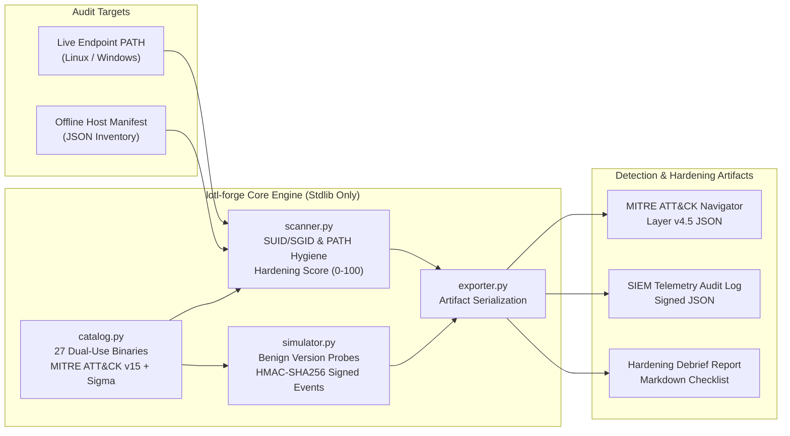

# Phantom — Cross-Platform LOLBins/GTFOBins Exposure & SIEM Telemetry Framework

**Cross-Platform Dual-Use Binary Hardening & SIEM Telemetry Verification Auditor**

`lotl-forge` is a zero-dependency Python 3.10+ security engineering utility designed for system administrators, purple-team engineers, and detection engineers. It audits Windows and Linux endpoints (or offline configuration management manifests) for dual-use administrative utility exposure, SUID/SGID privilege misconfigurations, writable `PATH` hygiene flaws, and SIEM telemetry ingestion coverage mapped to **MITRE ATT&CK v15**.

Built exclusively on the Python standard library (`os`, `sys`, `stat`, `pathlib`, `subprocess`, `json`, `hashlib`, `hmac`, `shutil`, `argparse`, `platform`, `datetime`), `lotl-forge` executes out-of-the-box on restricted production jump hosts, hardened Linux servers, and Windows workstations without external package installation.

---

## System Architecture



---

## Core Capabilities

1. **Curated Dual-OS Intelligence Catalog (`lotl_forge/catalog.py`)**:
   - **Windows Administrative Utilities (13 entries)**: `certutil.exe`, `mshta.exe`, `rundll32.exe`, `regsvr32.exe`, `bitsadmin.exe`, `wmic.exe`, `msiexec.exe`, `cmstp.exe`, `forfiles.exe`, `pcalua.exe`, `powershell.exe`, `csc.exe`, `installutil.exe`.
   - **Linux Administrative Utilities (14 entries)**: `python3`, `tar`, `find`, `openssl`, `curl`, `awk`, `vim`, `perl`, `rsync`, `busctl`, `env`, `setarch`, `gdb`, `capsh`.
   - Documents legitimate administrative purpose, MITRE ATT&CK v15 technique IDs (`T1218`, `T1059`, `T1548.001`, `T1105`, `T1202`), Windows Defender Application Control (WDAC) / AppLocker and Linux `chmod`/`setcap` hardening steps, expected Sysmon Event IDs / Linux `auditd` syscalls, and Sigma detection snippets.

2. **Read-Only Endpoint Posture Scanner (`lotl_forge/scanner.py`)**:
   - Evaluates live host `PATH` directories or offline JSON manifests (`--manifest <PATH>`).
   - Detects world-writable `PATH` directories lacking the sticky bit, unexpected SUID (`stat.S_ISUID`) or SGID (`stat.S_ISGID`) mode bits, Linux extended file capabilities (`security.capability`), and missing WDAC/AppLocker or `auditd` controls.
   - Computes a composite **Host Hardening Score (0-100)** and **Host Exposure Score (0-100)** with prioritized remediation commands.

3. **SIEM Telemetry Verification Recorder (`lotl_forge/simulator.py`)**:
   - Guarded by the mandatory `--confirm-authorized-scope` flag.
   - Runs strictly non-destructive version/help checks (`--version`, `/?`) using `subprocess.Popen(..., shell=False)` with a hard 5-second timeout, or emits synthetic Sysmon Event ID 1 / Linux `auditd` `SYSCALL_EXECVE` events via `--dry-run`.
   - Signs every telemetry record with a constant-time verifiable `HMAC-SHA256` digest (`hmac.compare_digest`) to guarantee audit log integrity.

4. **Multi-Format Reporting & ATT&CK Navigator Export (`lotl_forge/exporter.py`)**:
   - Exports **MITRE ATT&CK Navigator v4.5 JSON layers** (`--navigator-out`), structured JSON audit logs (`--json-out`), and Markdown hardening checklists (`--markdown-out`).

---

## MITRE ATT&CK v15 & Detection Engineering Mapping

| MITRE Technique ID | Technique Name | Catalog Binaries Covered | Primary Telemetry Source | Key Detection Fields / Syscalls |
| :--- | :--- | :--- | :--- | :--- |
| `T1218.003` | System Binary Proxy Execution: CMSTP | `cmstp.exe` | Sysmon Event ID 1, 7 | `Image`, `CommandLine` (`/s`, `/au`, `.inf`) |
| `T1218.004` | System Binary Proxy Execution: InstallUtil | `installutil.exe` | Sysmon Event ID 1, 7 | `Image`, `CommandLine` (`/logfile=`, `/U`) |
| `T1218.005` | System Binary Proxy Execution: Mshta | `mshta.exe` | Sysmon Event ID 1, 3, 7 | `Image`, `ParentImage`, `CommandLine` |
| `T1218.007` | System Binary Proxy Execution: Msiexec | `msiexec.exe` | Sysmon Event ID 1, 3, 11 | `Image`, `CommandLine` (`/q`, `http://`, `https://`) |
| `T1218.010` | System Binary Proxy Execution: Regsvr32 | `regsvr32.exe` | Sysmon Event ID 1, 3, 7 | `Image`, `CommandLine` (`/s`, `/u`, `/i:`, `scrobj.dll`) |
| `T1218.011` | System Binary Proxy Execution: Rundll32 | `rundll32.exe` | Sysmon Event ID 1, 7 | `Image`, `ImageLoaded`, `Signed`, `CommandLine` |
| `T1059.001` | Command and Scripting Interpreter: PowerShell | `powershell.exe` | PowerShell Operational 4103, 4104 | `ScriptBlockText`, `HostApplication`, `-enc` |
| `T1059.004` | Command and Scripting Interpreter: Unix Shell | `tar`, `awk`, `vim`, `busctl`, `capsh` | Linux `auditd` | `SYSCALL=execve`, `exe`, `proctitle`, `euid` |
| `T1059.006` | Command and Scripting Interpreter: Python | `python3` | Linux `auditd` | `SYSCALL=execve`, `socket`, `connect`, `proctitle` |
| `T1548.001` | Abuse Elevation Control Mechanism: Setuid and Setgid | `python3`, `tar`, `find`, `awk`, `vim`, `perl`, `rsync`, `env`, `setarch`, `gdb`, `capsh` | Linux `auditd` | `SYSCALL=execve`, `uid!=euid`, `stat.S_ISUID` |
| `T1105` | Ingress Tool Transfer | `certutil.exe`, `bitsadmin.exe`, `curl`, `openssl`, `rsync` | Sysmon ID 1, 3 / `auditd` | `DestinationIp`, `CommandLine` (`urlcache`, `/transfer`, `-o`) |
| `T1202` | Indirect Command Execution | `forfiles.exe`, `pcalua.exe`, `env`, `setarch` | Sysmon ID 1 / `auditd` | `ParentImage`, `CommandLine` (`/c`, `-a`, `-R`) |

---

## CLI Reference

| Subcommand | Flag | Description |
| :--- | :--- | :--- |
| `catalog` | `--os {all,linux,windows}` | Filter reference catalog entries by operating system. |
| `catalog` | `--technique <ID>` | Filter catalog entries by MITRE ATT&CK technique prefix (e.g. `T1218`, `T1548.001`). |
| `catalog` | `--binary <NAME>` | Inspect detailed hardening controls and Sigma rule snippet for a single binary. |
| `scan` | `--os {auto,linux,windows}` | Audit live endpoint `PATH` against the specified OS profile. |
| `scan` | `--manifest <PATH>` | Audit an offline JSON host inventory manifest (`samples/windows_server_manifest.json`). |
| `scan` | `--navigator-out <PATH>` | Export findings to a MITRE ATT&CK Navigator v4.5 JSON layer. |
| `scan` | `--json-out <PATH>` | Export structured posture findings to a JSON file. |
| `scan` | `--markdown-out <PATH>` | Export a prioritized Markdown remediation report. |
| `simulate` | `--confirm-authorized-scope` | Mandatory authorization gate to generate SIEM verification telemetry. |
| `simulate` | `--os {auto,linux,windows}` | Select target OS profile for telemetry verification. |
| `simulate` | `--technique <ID>` | Restrict telemetry verification to a specific MITRE ATT&CK technique. |
| `simulate` | `--dry-run` | Emit signed synthetic SIEM events without spawning child processes. |

---

## Sample Terminal Output Transcripts

### 1. Windows Server Manifest Audit (`scan --manifest`)

```text
$ python3 -m lotl_forge scan --manifest samples/windows_server_manifest.json
==============================================================================
LOTL-FORGE ENDPOINT POSTURE AUDIT | HOST: WIN-SRV-APP01.corp.internal (WINDOWS)
==============================================================================
Scan Mode              : manifest
Timestamp (UTC)        : 2026-10-23T23:54:46.520529+00:00
Host Hardening Score   : 39/100
Host Exposure Score    : 61/100 [HIGH]
Catalog Utilities Found: 8/13
High/Critical Findings : 4
Writable PATH Entries  : 1
------------------------------------------------------------------------------
BINARY             PRESENT  SEVERITY   SCORE  MITRE ATT&CK         NOTES
------------------------------------------------------------------------------
mshta.exe          YES      HIGH       10     T1218.005,T1059.005  High-risk dual-use utility present wit
certutil.exe       YES      HIGH       9      T1105,T1140          High-risk dual-use utility present wit
installutil.exe    YES      HIGH       9      T1218.004            High-risk dual-use utility present wit
regsvr32.exe       YES      HIGH       9      T1218.010            High-risk dual-use utility present wit
powershell.exe     YES      MEDIUM     8      T1059.001            Dual-use administrative utility availa
rundll32.exe       YES      MEDIUM     8      T1218.011            Dual-use administrative utility availa
wmic.exe           YES      MEDIUM     8      T1047,T1220          Dual-use administrative utility availa
bitsadmin.exe      YES      LOW        2      T1197,T1105          Execution restricted by host applicati
------------------------------------------------------------------------------
PRIORITIZED HARDENING REMEDIATIONS:
  1. Remove world-writable permissions or relative entries from PATH directories: C:\Temp\SharedTools
  2. Deploy Microsoft Recommended Block Rules via Windows Defender Application Control (WDAC) or AppLocker.
  3. [mshta.exe] Block mshta.exe execution enterprise-wide via WDAC user-mode block rules or AppLocker EXE rules unless explicitly required for legacy applications.
  4. [certutil.exe] Enforce Windows Defender Application Control (WDAC) or AppLocker rules restricting certutil.exe execution to PKI administrators.
  5. [installutil.exe] Block InstallUtil.exe via WDAC/AppLocker rules on non-developer workstations and servers.
  6. [regsvr32.exe] Restrict scrobj.dll loading or block outbound network access from regsvr32.exe via Windows Firewall.
==============================================================================
```

### 2. Linux Production Host Audit (`scan --manifest`)

```text
$ python3 -m lotl_forge scan --manifest samples/linux_prod_manifest.json
==============================================================================
LOTL-FORGE ENDPOINT POSTURE AUDIT | HOST: prd-k8s-worker-04.infra.internal (LINUX)
==============================================================================
Scan Mode              : manifest
Timestamp (UTC)        : 2026-10-23T23:54:46.625716+00:00
Host Hardening Score   : 25/100
Host Exposure Score    : 75/100 [CRITICAL]
Catalog Utilities Found: 6/14
High/Critical Findings : 4
Writable PATH Entries  : 1
------------------------------------------------------------------------------
BINARY             PRESENT  SEVERITY   SCORE  MITRE ATT&CK         NOTES
------------------------------------------------------------------------------
python3            YES      CRITICAL   32     T1059.006,T1548.001  CRITICAL: SUID bit (04000) is set on d
find               YES      CRITICAL   21     T1083,T1548.001      CRITICAL: SUID bit (04000) is set on d
tar                YES      HIGH       17     T1548.001,T1059.004  HIGH: Elevated Linux file capabilities
gdb                YES      HIGH       9      T1055.008,T1548.001  High-risk dual-use utility present wit
curl               YES      MEDIUM     8      T1105                Dual-use administrative utility availa
openssl            YES      MEDIUM     7      T1105,T1140          Dual-use administrative utility availa
------------------------------------------------------------------------------
PRIORITIZED HARDENING REMEDIATIONS:
  1. Remove world-writable permissions or relative entries from PATH directories: /opt/custom/bin
  2. Strip SUID/SGID mode bits from /usr/bin/python3: chmod u-s,g-s /usr/bin/python3
  3. Remove elevated file capabilities from /usr/bin/python3: setcap -r /usr/bin/python3
  4. Strip SUID/SGID mode bits from /usr/bin/find: chmod u-s,g-s /usr/bin/find
  5. Remove elevated file capabilities from /usr/bin/tar: setcap -r /usr/bin/tar
  6. Configure Linux auditd rules (-a always,exit -F arch=b64 -S execve,execveat) to log dual-use binary invocations.
==============================================================================
```

### 3. Safe SIEM Telemetry Verification (`simulate`)

```text
$ python3 -m lotl_forge simulate --confirm-authorized-scope --os windows --technique T1218 --dry-run
====================================================================================
LOTL-FORGE SIEM TELEMETRY VERIFICATION | RECORDS GENERATED: 6
====================================================================================
BINARY             MODE                 PID      EXIT   MITRE ATT&CK       HMAC PREFIX
------------------------------------------------------------------------------------
mshta.exe          dry-run-synthetic    SYNTH    0      T1218.005,T1059.005 a4e2f90b12c3
rundll32.exe       dry-run-synthetic    SYNTH    0      T1218.011          7b81d452091a
regsvr32.exe       dry-run-synthetic    SYNTH    0      T1218.010          c3198e77f204
msiexec.exe        dry-run-synthetic    SYNTH    0      T1218.007          f0921a6e883d
cmstp.exe          dry-run-synthetic    SYNTH    0      T1218.003          19d44b8a77e1
installutil.exe    dry-run-synthetic    SYNTH    0      T1218.004          5e88c21094ab
====================================================================================
```

---

## Testing & Security Hygiene Verification

Run the unit test suite and the automated zero-leak repository audit script:

```bash
chmod +x scripts/security-audit.sh
./scripts/security-audit.sh
```
